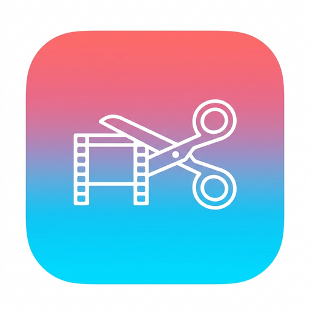

# 视频剪辑姬 (Video Cutie) v1.2.0

<div align="center">
  
  <h3>专为 macOS 设计的极简无损视频剪辑客户端</h3>
  <p><b>内置 FFmpeg 引擎 · 零终端命令 · 自定义导出保存路径 · 原画流复制毫秒级极速导出</b></p>
  <p>
    
    
    
    
  </p>
</div>

---

## ✨ 软件特色

1. **纯粹单页工作台**：去除一切多余标签页、冗余按钮与说明文字，聚焦拖入、裁剪、导出的极简操作流程。
2. **零终端命令行**：无需使用或复制任何终端命令，无需安装 Homebrew，客户端内一键极速剪辑导出。
3. **内置 FFmpeg 原生引擎**：已打包进应用安装包内部（`Contents/MacOS/ffmpeg`），开箱即用，免配置环境。
4. **自定义剪辑保存路径**：支持直观配置与选择保存路径（支持原生访达文件夹选择器及影片、下载、桌面等常用快捷预设），导出完成后可一键在访达中定位显示。
5. **音视频流直接复制（-c copy）**：无损剪辑，零画质重编码损失，数百兆视频 1 秒内完成导出。
6. **智能时间补全**：输入 `012536` 自动格式化补全为 `01:25:36`。未指定时默认从头裁剪至视频末尾。
7. **现代 macOS 纯净图标**：无黑边、无字符、全平圆角矩形，完全遵循 Apple Human Interface Guidelines。
8. **Universal 通用二进制**：原生同时支持 Apple Silicon（M1/M2/M3/M4）与 Intel（x86_64）芯片。

---

## 🚀 GitHub Actions 自动构建与发布

本仓库已配置完整的自动化 CI/CD 工作流（`.github/workflows/build-dmg.yml`）：
- 代码推送至 GitHub 后，在 **Actions** 标签页可手动触发打包；
- 自动构建内置 FFmpeg 的 Universal `.dmg` 安装包；
- 自动在 GitHub Releases 中发布，标题为：`视频剪辑姬（Video Cutie）v1.2.0`。

---

## 💻 本地开发与调试

```bash
# 安装依赖
npm install

# 启动本地开发服务
npm run dev

# 编译 Web 客户端
npm run build

# macOS 本地打包 DMG
npm run build:dmg
```

---

## 📄 License
Copyright © 2026 视频剪辑姬 (Video Cutie). All rights reserved.
